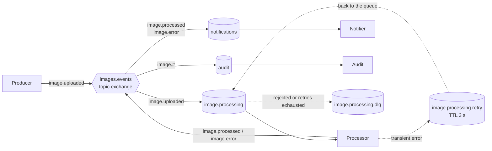

# SD5 Lab 4: Message Broker and Event Bus

Basic event-driven flow with RabbitMQ, written in TypeScript. A producer publishes `ImageUploaded`
events to an event bus (a RabbitMQ topic exchange). Three consumers subscribe to the events they
need. The flow includes retries with delay, a dead-letter queue per consumer, idempotent consumers
and persistent messages.



## Requirements

- Docker (Docker Desktop on Windows)
- Node.js 22

## Setup

```bash
npm ci
docker compose up -d
```

RabbitMQ listens on `localhost:5672`. The management console is at http://localhost:15672
(user `lab`, password `lab`). The exchanges and queues are created by the consumers when they start.

## Run the flow

Open one terminal per consumer:

```bash
npm run consumer:processor
npm run consumer:notifier
npm run consumer:audit
```

Then publish events from another terminal:

```bash
npm run produce -- --count 3
```

## Scenarios

| Command                                   | What happens                                                                                     |
| ----------------------------------------- | ------------------------------------------------------------------------------------------------ |
| `npm run produce -- --count 3`            | Normal flow: the processor publishes `ImageProcessed`, the notifier and the audit receive it     |
| `npm run produce -- --scenario corrupt`   | The processor publishes `ProcessingError`; the notifier reports the failure                      |
| `npm run produce -- --scenario flaky`     | The processor fails twice with a transient error and succeeds on the third attempt               |
| `npm run produce -- --scenario down`      | The processor fails every time; after 3 retries the message goes to `image.processing.dlq`       |
| `npm run produce -- --scenario invalid`   | An invalid JSON and an event without required fields go to the dead-letter queue without retries |
| `npm run produce -- --scenario duplicate` | The same event is published twice; the second delivery is skipped                                |
| `npm run produce -- --scenario crash`     | The processor exits before acknowledging the message; RabbitMQ delivers it again                 |

To see the load distributed between competing consumers, start two processors with different
names (PowerShell: `$env:INSTANCE="A"; npm run consumer:processor`; bash:
`INSTANCE=A npm run consumer:processor`) and publish several events.

To check persistence, stop the consumers, publish events, run `docker compose restart rabbitmq` and
start the consumers again: the events are still in the queues.

## Design

| Concern            | Implementation                                                                         |
| ------------------ | -------------------------------------------------------------------------------------- |
| Event bus          | Topic exchange `images.events`; consumers bind their queue with routing key patterns   |
| Delivery guarantee | Publisher confirms, durable queues, persistent messages and manual acknowledgements    |
| Validation         | Every consumer validates the event against a Zod schema; invalid messages are rejected |
| Retries            | Transient errors are republished to a retry queue with a 3 s TTL, up to 3 times        |
| Dead letters       | Rejected messages are dead-lettered by RabbitMQ to `<queue>.dlq`                       |
| Idempotency        | Each consumer skips event ids it has already processed (kept in memory for this lab)   |
| Correlation        | The `correlationId` of the original event is copied to the events it causes            |

## Project structure

```text
src/
  config.ts           Broker URL, exchanges, routing keys and retry settings
  events.ts           Event envelope, schemas and createEvent
  topology.ts         Declares the exchanges, queues, retry queues and dead-letter queues
  bus.ts              EventBus: publish, subscribe, validation, retries, dead letters, idempotency
  producer.ts         Publishes ImageUploaded events for each scenario
  consumers/
    processor.ts      Consumes image.uploaded and publishes the result
    notifier.ts       Consumes image.processed and image.error
    audit.ts          Consumes every image.* event
```

## Clean up

```bash
docker compose down -v
```
